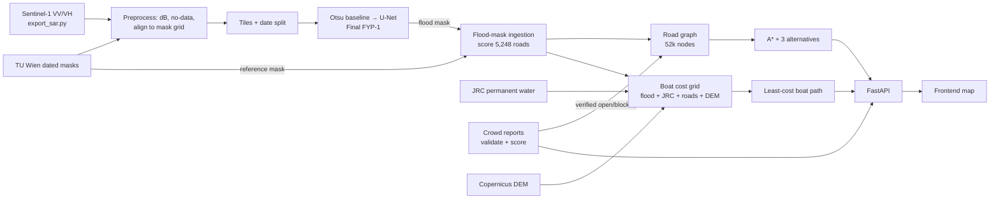

# Pipeline

Cost formulas

- Road edge: `cost = length × (1 + 20 × flooded share + 2 × unknown share)`; verified-blocked edges are removed, verified-open edges lose the flood penalty.
- Boat cell: `cost = 1 + obstacle + uncertainty + terrain + report` (weights in `config/config.yaml → boat.penalties`).
